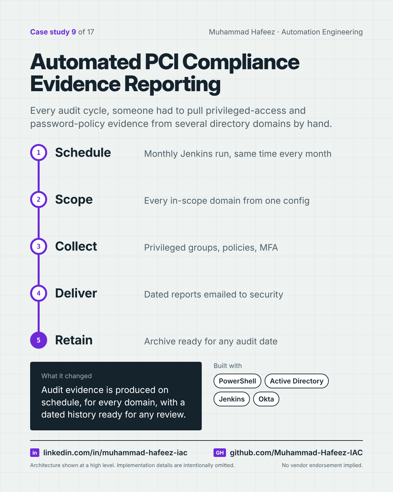

# Automated PCI Compliance Evidence Reporting



## What it did

A scheduled Jenkins job that runs a set of PowerShell reports across multiple Active Directory domains — privileged group membership, local administrators on servers, password policy and multi-factor enrollment — then emails them to the security team and keeps a dated archive for quarterly reviews and the annual PCI assessment.

## How it works

1. **Schedule** — Monthly Jenkins run, same time every month
2. **Scope** — Every in-scope domain from one config
3. **Collect** — Privileged groups, policies, MFA
4. **Deliver** — Dated reports emailed to security
5. **Retain** — Archive ready for any audit date

**Built with:** PowerShell · Active Directory module · Jenkins · Okta · SMTP · XML/CSV

## Snippet

A simplified example that shows the idea. It is not taken from the original code.

```powershell
# Export privileged group membership, including nested groups (illustrative)
$date = Get-Date -Format yyyy-MM-dd
Get-ADGroupMember -Identity 'Domain Admins' -Recursive |
    Get-ADUser -Properties Enabled |
    Where-Object Enabled |
    Select-Object Name, SamAccountName |
    Export-Csv "evidence\DomainAdmins_$date.csv" -NoTypeInformation
```

---

Implementation details, source code and internal names are intentionally not published.

**Muhammad Hafeez** · [LinkedIn](https://www.linkedin.com/in/muhammad-hafeez-iac) · [GitHub](https://github.com/Muhammad-Hafeez-IAC) · [All projects](../README.md)
