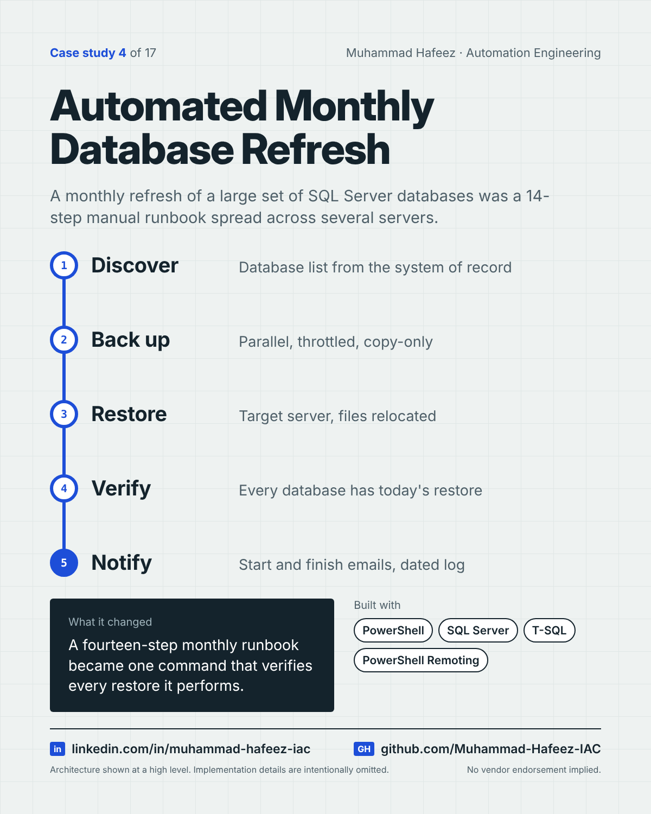

# Automated Monthly Database Refresh



## What it did

A PowerShell orchestrator that discovers which databases need refreshing, backs them up in parallel across source servers, restores them on a target server, verifies every restore, runs post-restore preparation, and notifies stakeholders at start and finish.

## How it works

1. **Discover** — Database list from the system of record
2. **Back up** — Parallel, throttled, copy-only
3. **Restore** — Target server, files relocated
4. **Verify** — Every database has today's restore
5. **Notify** — Start and finish emails, dated log

**Built with:** PowerShell · Microsoft SQL Server · SqlServer module · PowerShell Remoting · SMTP · JSON configuration

## Snippet

A simplified example that shows the idea. It is not taken from the original code.

```powershell
# Run backups in parallel, but never more than N at once (illustrative)
$maxJobs = 4
foreach ($db in $databases) {
    while ((Get-Job -State Running).Count -ge $maxJobs) { Start-Sleep 5 }
    Start-Job -ScriptBlock { param($name) Backup-Database $name } -ArgumentList $db
}
Get-Job | Wait-Job | Receive-Job
```

---

Implementation details, source code and internal names are intentionally not published.

**Muhammad Hafeez** · [LinkedIn](https://www.linkedin.com/in/muhammad-hafeez-iac) · [GitHub](https://github.com/Muhammad-Hafeez-IAC) · [All projects](../README.md)
