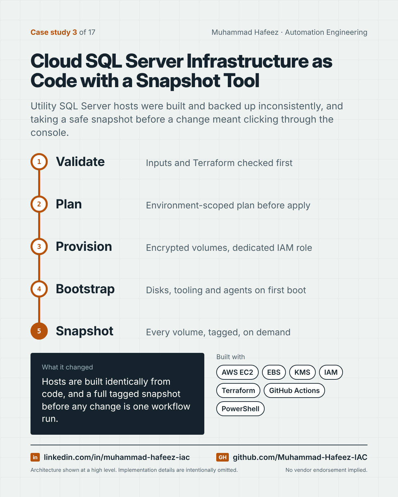

# Cloud SQL Server Infrastructure as Code with a Snapshot Tool



## What it did

Terraform modules and GitHub Actions workflows that build Windows SQL Server hosts on AWS with encrypted storage, a dedicated IAM role and an automated bootstrap — plus a separate, stateless workflow that snapshots every volume of a named instance on demand.

## How it works

1. **Validate** — Inputs and Terraform checked first
2. **Plan** — Environment-scoped plan before apply
3. **Provision** — Encrypted volumes, dedicated IAM role
4. **Bootstrap** — Disks, tooling and agents on first boot
5. **Snapshot** — Every volume, tagged, on demand

**Built with:** AWS EC2 + EBS · AWS KMS · AWS IAM · Amazon S3 · Terraform · GitHub Actions · PowerShell · Windows Server + SQL Server

## Snippet

A simplified example that shows the idea. It is not taken from the original code.

```hcl
# Snapshot every volume attached to one instance, tagged with why (illustrative)
data "aws_instance" "target" {
  filter {
    name   = "tag:Name"
    values = [var.instance_name]
  }
}

resource "aws_ebs_snapshot" "this" {
  for_each  = toset(var.volume_ids)
  volume_id = each.value
  tags      = { Reason = var.reason, Retention = "14d" }
}
```

---

Implementation details, source code and internal names are intentionally not published.

**Muhammad Hafeez** · [LinkedIn](https://www.linkedin.com/in/muhammad-hafeez-iac) · [GitHub](https://github.com/Muhammad-Hafeez-IAC) · [All projects](../README.md)
