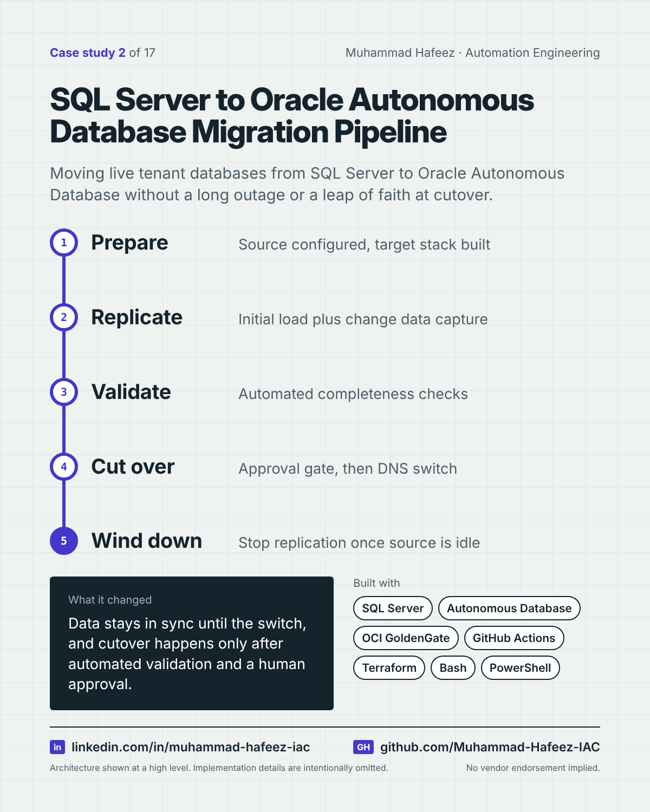

# SQL Server to Oracle Autonomous Database Migration Pipeline



## What it did

A staged GitHub Actions pipeline that migrates tenant databases from Microsoft SQL Server to Oracle Autonomous Database using OCI GoldenGate for initial load and continuous replication, with automated validation, an approval-gated cutover and a DNS switch.

## How it works

1. **Prepare** — Source configured, target stack built
2. **Replicate** — Initial load plus change data capture
3. **Validate** — Automated completeness checks
4. **Cut over** — Approval gate, then DNS switch
5. **Wind down** — Stop replication once source is idle

**Built with:** Microsoft SQL Server · Oracle Autonomous Database · OCI GoldenGate · GitHub Actions · Terraform · Bash + jq · PowerShell · OCI CLI · Docker

## Snippet

A simplified example that shows the idea. It is not taken from the original code.

```yaml
# Cutover only runs after validation passes and a person approves (illustrative)
jobs:
  validate:
    runs-on: ubuntu-latest
    steps:
      - run: ./validate.sh   # compare source and target
  cutover:
    needs: validate
    environment: production-approval   # manual approval gate
    runs-on: ubuntu-latest
    steps:
      - run: ./switch-dns.sh
```

---

Implementation details, source code and internal names are intentionally not published.

**Muhammad Hafeez** · [LinkedIn](https://www.linkedin.com/in/muhammad-hafeez-iac) · [GitHub](https://github.com/Muhammad-Hafeez-IAC) · [All projects](../README.md)
