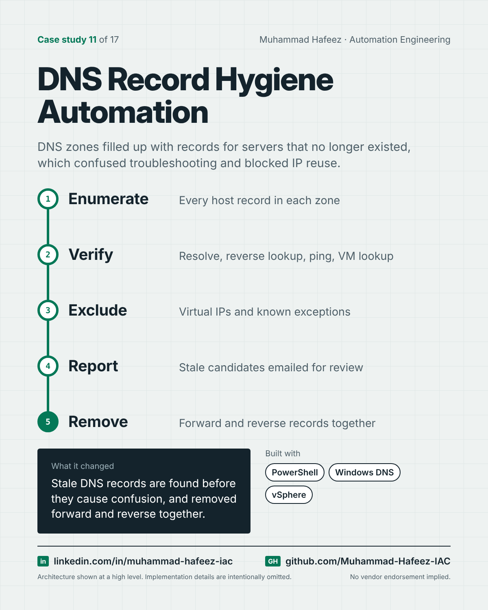

# DNS Record Hygiene Automation



## What it did

PowerShell tooling that audits DNS zones against reality — name resolution, reverse records, ping and the virtualization inventory — reports records that look stale, and removes forward and reverse records for decommissioned hosts, finding the right reverse zone automatically.

## How it works

1. **Enumerate** — Every host record in each zone
2. **Verify** — Resolve, reverse lookup, ping, VM lookup
3. **Exclude** — Virtual IPs and known exceptions
4. **Report** — Stale candidates emailed for review
5. **Remove** — Forward and reverse records together

**Built with:** PowerShell · Windows DNS Server · VMware vSphere · ICMP / DNS resolution · SMTP

## Snippet

A simplified example that shows the idea. It is not taken from the original code.

```powershell
# A record is a cleanup candidate only if nothing says it is alive (illustrative)
$alive = (Resolve-DnsName $name -ErrorAction SilentlyContinue) -and
         (Test-Connection $name -Count 1 -Quiet)
if (-not $alive -and -not (Test-VmExists $name)) {
    $staleRecords += $name   # report first, delete later
}
```

---

Implementation details, source code and internal names are intentionally not published.

**Muhammad Hafeez** · [LinkedIn](https://www.linkedin.com/in/muhammad-hafeez-iac) · [GitHub](https://github.com/Muhammad-Hafeez-IAC) · [All projects](../README.md)
