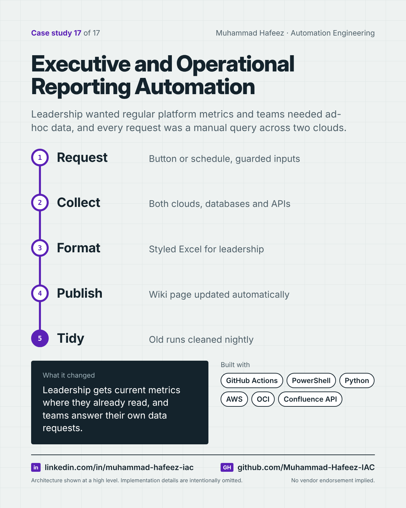

# Executive and Operational Reporting Automation



## What it did

A set of GitHub Actions workflows that produce reports across AWS- and OCI-hosted environments: a 12-month transaction-metrics report formatted for leadership and published to the team wiki, an environment inventory report, backup, storage and machine-image reports, a guarded query tool across tenant databases, log search and usage reports — on demand or on a schedule.

## How it works

1. **Request** — Button or schedule, guarded inputs
2. **Collect** — Both clouds, databases and APIs
3. **Format** — Styled Excel for leadership
4. **Publish** — Wiki page updated automatically
5. **Tidy** — Old runs cleaned nightly

**Built with:** GitHub Actions · PowerShell · Python (openpyxl) · Bash · AWS + Oracle Cloud Infrastructure · SQL Server + Oracle Autonomous Database · Confluence REST API · Amazon CloudWatch Logs

## Snippet

A simplified example that shows the idea. It is not taken from the original code.

```python
# Turn a raw export into a readable workbook for leadership (illustrative)
from openpyxl import load_workbook
from openpyxl.styles import Font, PatternFill

wb = load_workbook("report.xlsx")
ws = wb.active
for cell in ws[1]:
    cell.font = Font(bold=True, color="FFFFFF")
    cell.fill = PatternFill("solid", fgColor="1F3A5F")
ws.freeze_panes = "A2"
wb.save("report.xlsx")
```

---

Implementation details, source code and internal names are intentionally not published.

**Muhammad Hafeez** · [LinkedIn](https://www.linkedin.com/in/muhammad-hafeez-iac) · [GitHub](https://github.com/Muhammad-Hafeez-IAC) · [All projects](../README.md)
