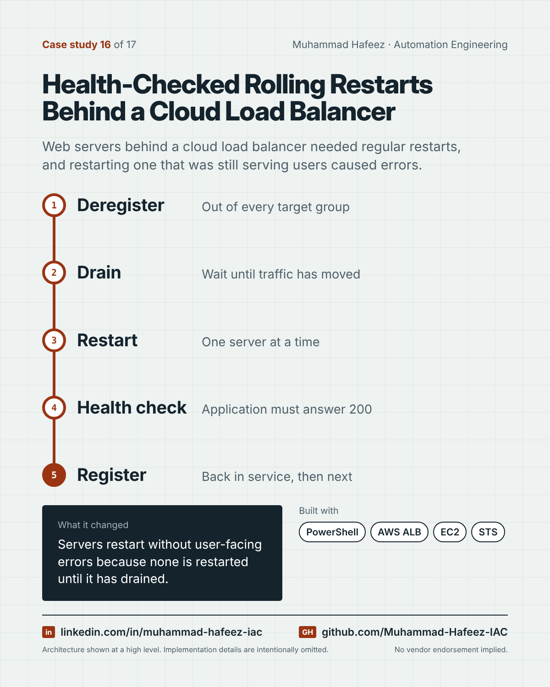

# Health-Checked Rolling Restarts Behind a Cloud Load Balancer



## What it did

A PowerShell tool that restarts Windows web servers behind an AWS Application Load Balancer in a fixed order: each server is deregistered from every target group, the tool waits until it has fully drained, restarts it, polls the application's health page until it answers, and only then registers it back and moves to the next.

## How it works

1. **Deregister** — Out of every target group
2. **Drain** — Wait until traffic has moved
3. **Restart** — One server at a time
4. **Health check** — Application must answer 200
5. **Register** — Back in service, then next

**Built with:** PowerShell · AWS Elastic Load Balancing (ALB) · Amazon EC2 · AWS STS · Windows Server + IIS-hosted app

## Snippet

A simplified example that shows the idea. It is not taken from the original code.

```powershell
# Drain, restart, health-check, return - one server at a time (illustrative)
foreach ($server in $servers) {
    Remove-FromTargetGroups $server
    while (Test-StillRegistered $server) { Start-Sleep 30 }
    Restart-Computer $server -Wait
    while ((Invoke-WebRequest "http://$server/health").StatusCode -ne 200) { Start-Sleep 15 }
    Add-ToTargetGroups $server
}
```

---

Implementation details, source code and internal names are intentionally not published.

**Muhammad Hafeez** · [LinkedIn](https://www.linkedin.com/in/muhammad-hafeez-iac) · [GitHub](https://github.com/Muhammad-Hafeez-IAC) · [All projects](../README.md)
