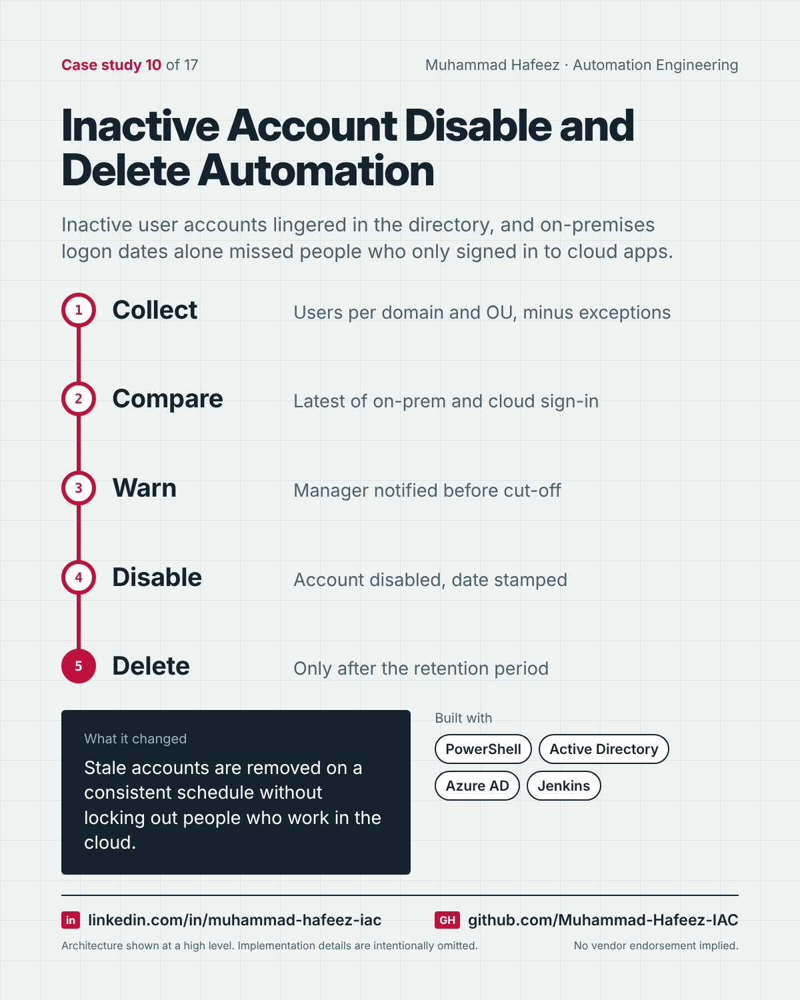

# Inactive Account Disable and Delete Automation



## What it did

Scheduled PowerShell automation that finds inactive user accounts using the most recent of on-premises and cloud sign-in dates, disables them after a set period while honoring exceptions, records when each was disabled, and deletes them after a further retention period — with manager notifications in the newer rules-based version.

## How it works

1. **Collect** — Users per domain and OU, minus exceptions
2. **Compare** — Latest of on-prem and cloud sign-in
3. **Warn** — Manager notified before cut-off
4. **Disable** — Account disabled, date stamped
5. **Delete** — Only after the retention period

**Built with:** PowerShell · Active Directory · Azure AD (Entra ID) · Jenkins / GitLab CI · JSON configuration · SMTP

## Snippet

A simplified example that shows the idea. It is not taken from the original code.

```powershell
# Activity = whichever sign-in is more recent: on-prem or cloud (illustrative)
$lastSeen = @($onPremLastLogon, $cloudLastSignIn) |
    Where-Object { $_ } | Sort-Object -Descending | Select-Object -First 1

if ((Get-Date) - $lastSeen -gt [TimeSpan]::FromDays(30)) {
    Disable-Account $user
    Set-DisabledDate $user (Get-Date)
}
```

---

Implementation details, source code and internal names are intentionally not published.

**Muhammad Hafeez** · [LinkedIn](https://www.linkedin.com/in/muhammad-hafeez-iac) · [GitHub](https://github.com/Muhammad-Hafeez-IAC) · [All projects](../README.md)
