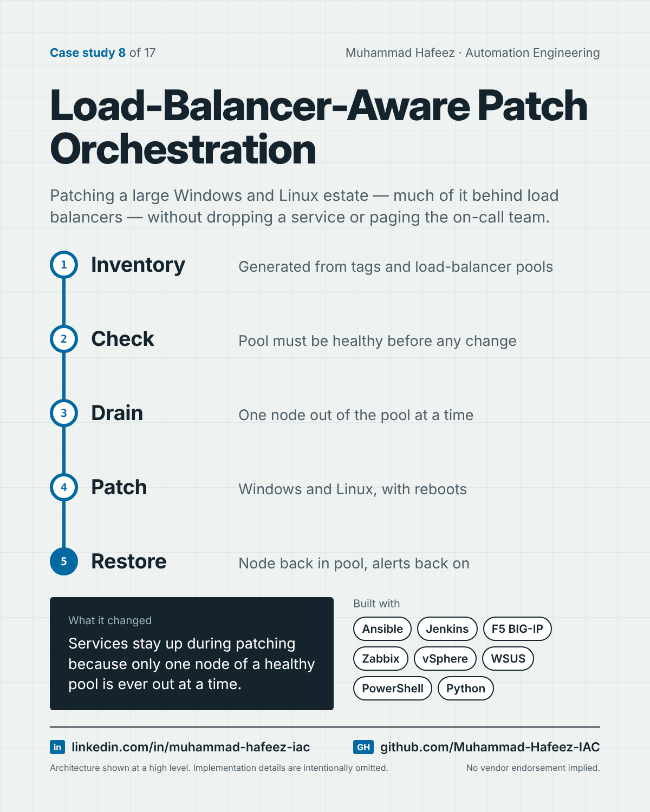

# Load-Balancer-Aware Patch Orchestration



## What it did

A family of Ansible playbooks, launched from Jenkins, that patches Windows and Linux servers on a scheduled patch-day rotation. Servers behind a load balancer are drained, patched and returned one at a time, only while the pool is healthy; standalone servers and VM templates follow their own paths. Inventory is generated from the virtualization platform and load balancer instead of being maintained by hand.

## How it works

1. **Inventory** — Generated from tags and load-balancer pools
2. **Check** — Pool must be healthy before any change
3. **Drain** — One node out of the pool at a time
4. **Patch** — Windows and Linux, with reboots
5. **Restore** — Node back in pool, alerts back on

**Built with:** Ansible · Jenkins · F5 BIG-IP · Zabbix · VMware vSphere · WSUS · PowerShell · Python + MySQL · Windows Server + Ubuntu Linux

## Snippet

A simplified example that shows the idea. It is not taken from the original code.

```yaml
# Patch load-balanced servers one at a time, only if the pool is healthy (illustrative)
- hosts: web_pool
  serial: 1
  tasks:
    - name: Pool must be healthy before we touch anything
      assert:
        that: pool_healthy_members | int > 1
    - name: Drain this node
      include_tasks: drain.yml
    - name: Patch and reboot
      include_tasks: patch.yml
  handlers:
    - name: Return node to pool
      include_tasks: enable.yml
```

---

Implementation details, source code and internal names are intentionally not published.

**Muhammad Hafeez** · [LinkedIn](https://www.linkedin.com/in/muhammad-hafeez-iac) · [GitHub](https://github.com/Muhammad-Hafeez-IAC) · [All projects](../README.md)
