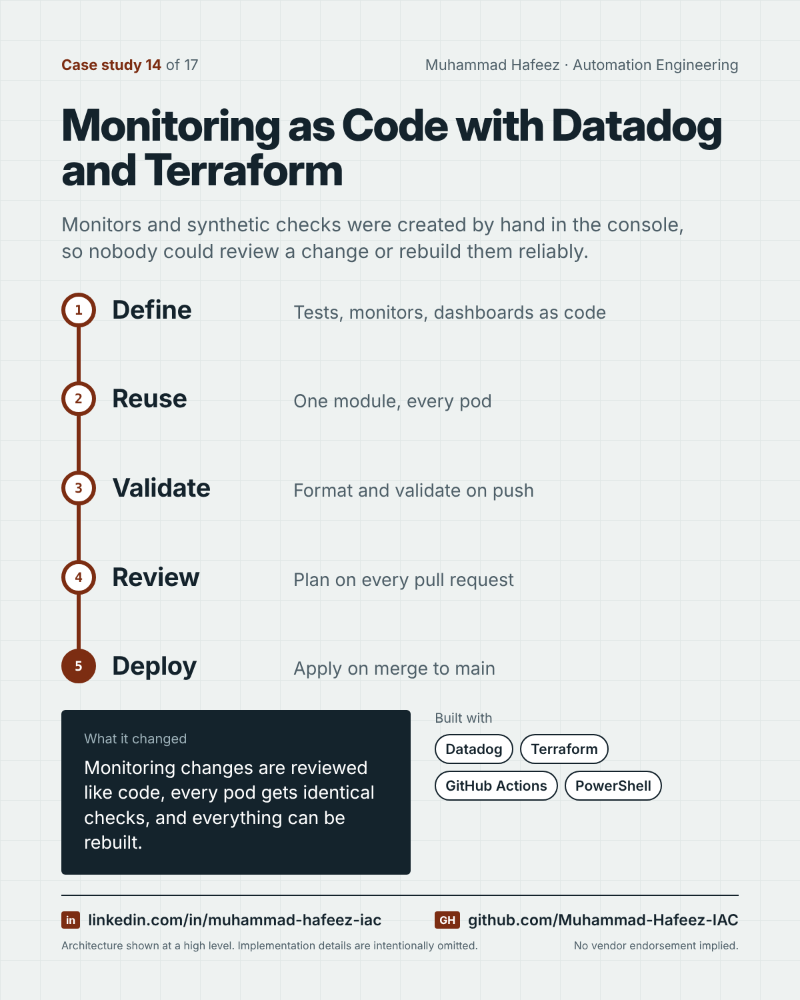

# Monitoring as Code with Datadog and Terraform



## What it did

Terraform projects that define Datadog synthetic tests, monitors and dashboards for a multi-component cloud application, deployed through GitHub Actions: validation on every push, a plan on every pull request, and an apply when changes merge to the main branch.

## How it works

1. **Define** — Tests, monitors, dashboards as code
2. **Reuse** — One module, every pod
3. **Validate** — Format and validate on push
4. **Review** — Plan on every pull request
5. **Deploy** — Apply on merge to main

**Built with:** Datadog · Terraform · GitHub Actions · PowerShell · JSON · AWS

## Snippet

A simplified example that shows the idea. It is not taken from the original code.

```hcl
# Same API check for every pod, defined once (illustrative)
resource "datadog_synthetics_test" "health" {
  for_each  = toset(var.pods)
  name      = "Health check - ${each.key}"
  type      = "api"
  status    = "live"
  locations = ["aws:us-east-2"]
  request_definition {
    method = "GET"
    url    = "https://${each.key}.example.com/health"
  }
  assertion { type = "statusCode", operator = "is", target = "200" }
}
```

---

Implementation details, source code and internal names are intentionally not published.

**Muhammad Hafeez** · [LinkedIn](https://www.linkedin.com/in/muhammad-hafeez-iac) · [GitHub](https://github.com/Muhammad-Hafeez-IAC) · [All projects](../README.md)
