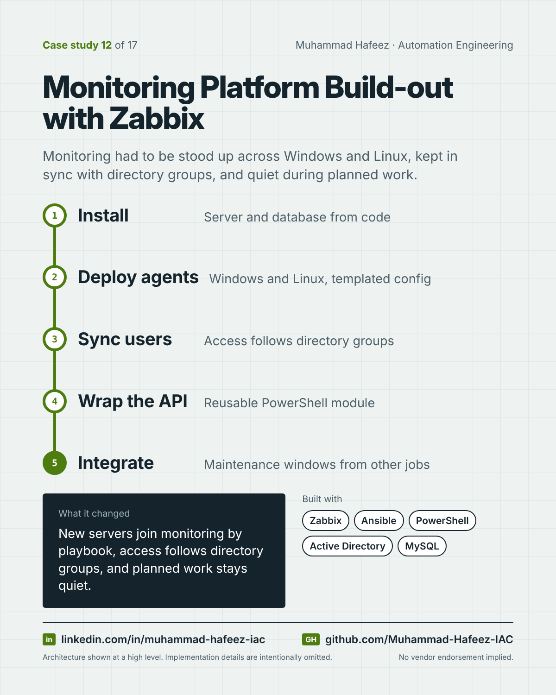

# Monitoring Platform Build-out with Zabbix



## What it did

Ansible and PowerShell automation that stood up a Zabbix monitoring server, rolled out agents to Windows and Linux servers, kept Zabbix users in sync with directory groups, and gave other automation (patching and decommissioning) a PowerShell module to open and close maintenance windows through the Zabbix API.

## How it works

1. **Install** — Server and database from code
2. **Deploy agents** — Windows and Linux, templated config
3. **Sync users** — Access follows directory groups
4. **Wrap the API** — Reusable PowerShell module
5. **Integrate** — Maintenance windows from other jobs

**Built with:** Zabbix · Ansible · PowerShell · Active Directory · MySQL · Jinja2 templates · GitLab CI / Jenkins

## Snippet

A simplified example that shows the idea. It is not taken from the original code.

```powershell
# Pause alerts for one host during planned work (illustrative)
$body = @{
    jsonrpc = '2.0'; method = 'maintenance.create'; id = 1
    params  = @{ name = "Patching $hostName"; hostids = @($hostId)
                 active_since = $start; active_till = $end }
} | ConvertTo-Json -Depth 5
Invoke-RestMethod -Uri $apiUrl -Method Post -Body $body -ContentType 'application/json'
```

---

Implementation details, source code and internal names are intentionally not published.

**Muhammad Hafeez** · [LinkedIn](https://www.linkedin.com/in/muhammad-hafeez-iac) · [GitHub](https://github.com/Muhammad-Hafeez-IAC) · [All projects](../README.md)
