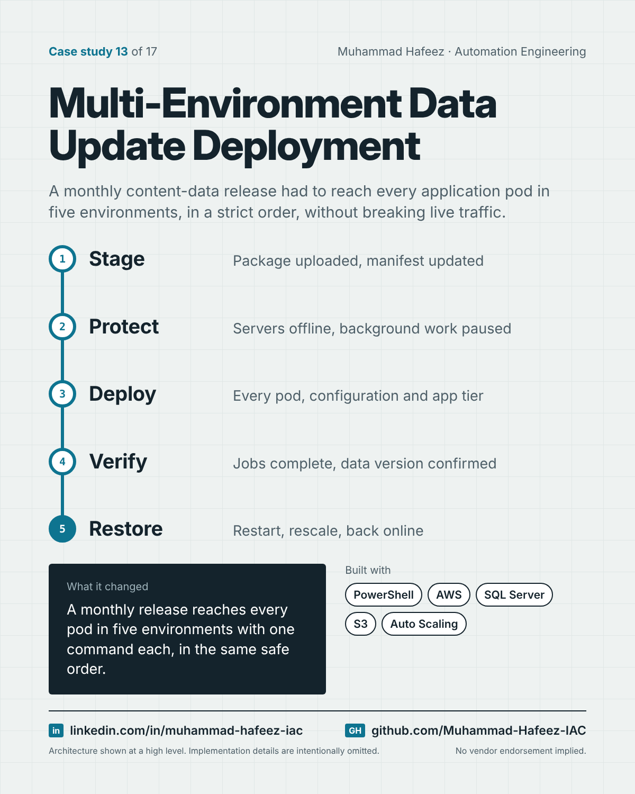

# Multi-Environment Data Update Deployment



## What it did

A PowerShell orchestrator that deploys a monthly data-update package to an application platform running in AWS. One entry point takes the environment and update type and runs that environment's playbook: stage the package, take servers out of rotation, pause background jobs, deploy to every pod, refresh reporting databases, restart and rescale servers, and bring everything back online, with notifications and a dated log.

## How it works

1. **Stage** — Package uploaded, manifest updated
2. **Protect** — Servers offline, background work paused
3. **Deploy** — Every pod, configuration and app tier
4. **Verify** — Jobs complete, data version confirmed
5. **Restore** — Restart, rescale, back online

**Built with:** PowerShell · AWS (EC2, S3, Auto Scaling, Step Functions, RDS) · Microsoft SQL Server / T-SQL · PowerShell Remoting · JSON configuration · Encrypted credential store

## Snippet

A simplified example that shows the idea. It is not taken from the original code.

```powershell
# One entry point, one playbook per environment (illustrative)
param([ValidateSet('Dev','QA','Stage','Prod')] $Environment, $Package)

switch ($Environment) {
    'Prod'  { Invoke-ProdRelease  -Package $Package }
    'Stage' { Invoke-StageRelease -Package $Package }
    default { Invoke-LowerRelease -Package $Package -Environment $Environment }
}
```

---

Implementation details, source code and internal names are intentionally not published.

**Muhammad Hafeez** · [LinkedIn](https://www.linkedin.com/in/muhammad-hafeez-iac) · [GitHub](https://github.com/Muhammad-Hafeez-IAC) · [All projects](../README.md)
