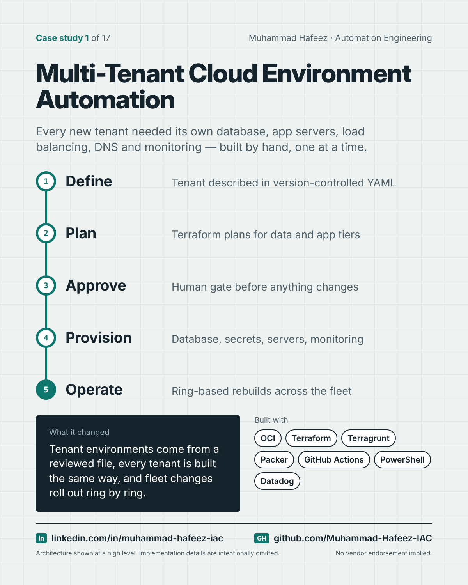

# Multi-Tenant Cloud Environment Automation



## What it did

A GitHub Actions platform that turns a single tenant definition file into a complete, isolated application environment on Oracle Cloud Infrastructure, and then keeps the whole fleet of tenants patched, rebuilt and, when needed, safely decommissioned.

## How it works

1. **Define** — Tenant described in version-controlled YAML
2. **Plan** — Terraform plans for data and app tiers
3. **Approve** — Human gate before anything changes
4. **Provision** — Database, secrets, servers, monitoring
5. **Operate** — Ring-based rebuilds across the fleet

**Built with:** Oracle Cloud Infrastructure · Terraform · Terragrunt · Packer · GitHub Actions · PowerShell · Windows Server · Datadog · YAML

## Snippet

A simplified example that shows the idea. It is not taken from the original code.

```yaml
# A tenant described as data, not as a runbook (illustrative)
tenant:
  name: example-tenant
  environment: dev
  database:
    size: small
  app_tier:
    servers: 2
  monitoring:
    synthetic_checks: true
```

---

Implementation details, source code and internal names are intentionally not published.

**Muhammad Hafeez** · [LinkedIn](https://www.linkedin.com/in/muhammad-hafeez-iac) · [GitHub](https://github.com/Muhammad-Hafeez-IAC) · [All projects](../README.md)
