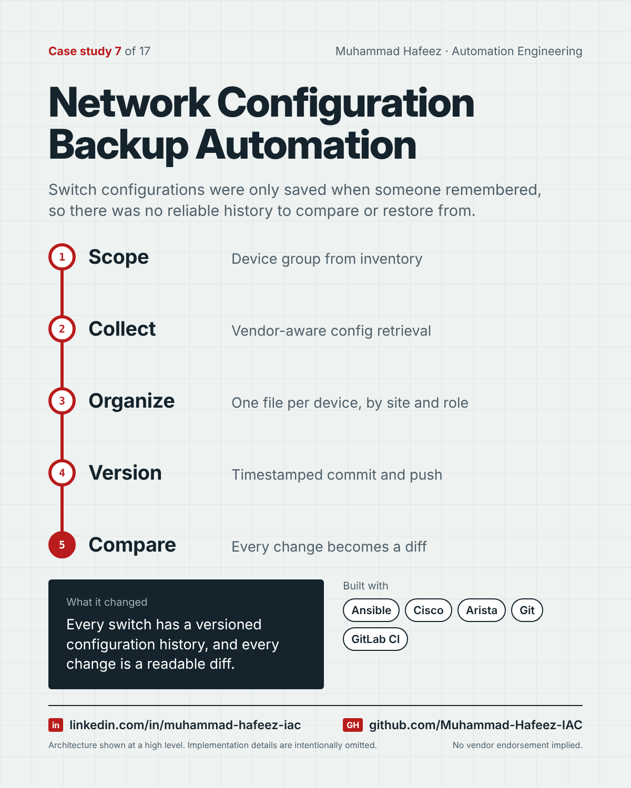

# Network Configuration Backup Automation



## What it did

An Ansible playbook that collects running configurations from network devices across sites, files them in a consistent folder hierarchy, and commits them to Git with a timestamp — turning configuration backup into a versioned, diffable history.

## How it works

1. **Scope** — Device group from inventory
2. **Collect** — Vendor-aware config retrieval
3. **Organize** — One file per device, by site and role
4. **Version** — Timestamped commit and push
5. **Compare** — Every change becomes a diff

**Built with:** Ansible · Cisco IOS · Arista EOS · Git · GitLab CI · SSH + Linux

## Snippet

A simplified example that shows the idea. It is not taken from the original code.

```yaml
# Save each device's configuration, then commit the changes (illustrative)
- name: Collect running configuration
  cli_command:
    command: show running-config
  register: config

- name: Save to file
  copy:
    content: "{{ config.stdout }}"
    dest: "backups/{{ site }}/{{ inventory_hostname }}.cfg"
```

---

Implementation details, source code and internal names are intentionally not published.

**Muhammad Hafeez** · [LinkedIn](https://www.linkedin.com/in/muhammad-hafeez-iac) · [GitHub](https://github.com/Muhammad-Hafeez-IAC) · [All projects](../README.md)
