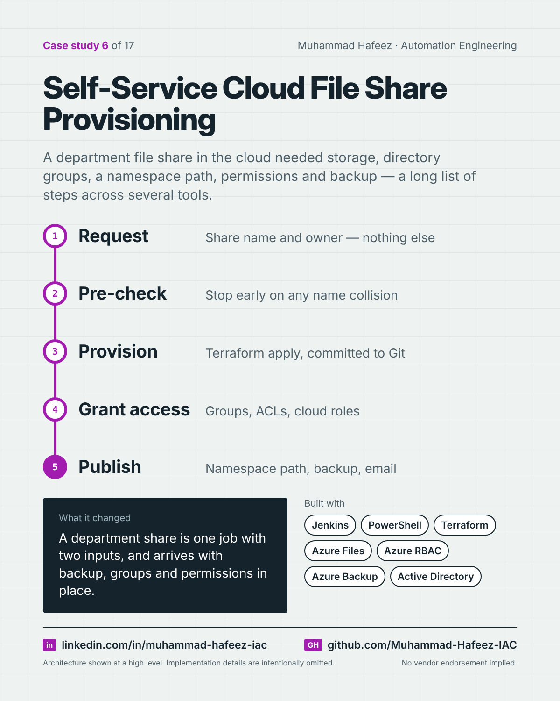

# Self-Service Cloud File Share Provisioning



## What it did

A parameterized Jenkins pipeline that creates a department file share on Azure Files from two inputs — the share name and its owner — including pre-checks, Terraform provisioning, backup enrollment, directory groups, a namespace path, permissions and notifications.

## How it works

1. **Request** — Share name and owner — nothing else
2. **Pre-check** — Stop early on any name collision
3. **Provision** — Terraform apply, committed to Git
4. **Grant access** — Groups, ACLs, cloud roles
5. **Publish** — Namespace path, backup, email

**Built with:** Jenkins · PowerShell · Terraform (azurerm) · Azure Files · Azure RBAC · Azure Backup · Active Directory + directory sync · DFS Namespaces · Git

## Snippet

A simplified example that shows the idea. It is not taken from the original code.

```groovy
// One job, two inputs, stages in a safe order (illustrative)
pipeline {
  agent any
  parameters { string(name: 'SHARE_NAME'); string(name: 'OWNER') }
  stages {
    stage('Pre-check') { steps { pwsh './Test-NameIsFree.ps1' } }
    stage('Provision') { steps { sh 'terraform apply -auto-approve' } }
    stage('Access')    { steps { pwsh './Grant-Access.ps1' } }
    stage('Notify')    { steps { pwsh './Send-Summary.ps1' } }
  }
}
```

---

Implementation details, source code and internal names are intentionally not published.

**Muhammad Hafeez** · [LinkedIn](https://www.linkedin.com/in/muhammad-hafeez-iac) · [GitHub](https://github.com/Muhammad-Hafeez-IAC) · [All projects](../README.md)
