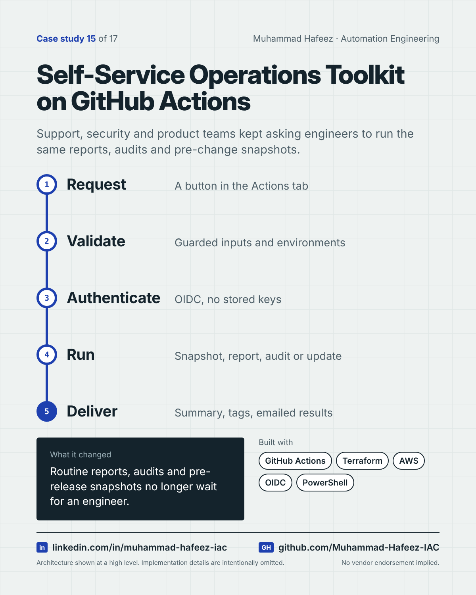

# Self-Service Operations Toolkit on GitHub Actions



## What it did

A repository of GitHub Actions workflows that turns recurring operational requests into self-service buttons and schedules: database server snapshots before monthly releases (with restore), scheduled directory access audits, monthly operational reports, and controlled data-update jobs — with keyless cloud authentication.

## How it works

1. **Request** — A button in the Actions tab
2. **Validate** — Guarded inputs and environments
3. **Authenticate** — OIDC, no stored keys
4. **Run** — Snapshot, report, audit or update
5. **Deliver** — Summary, tags, emailed results

**Built with:** GitHub Actions · Terraform · AWS (EC2, EBS, IAM, OIDC) · PowerShell · Active Directory · Microsoft SQL Server

## Snippet

A simplified example that shows the idea. It is not taken from the original code.

```yaml
# A self-service button with guarded inputs and keyless cloud access (illustrative)
on:
  workflow_dispatch:
    inputs:
      environment:
        type: choice
        options: [staging, production]
permissions:
  id-token: write   # OIDC - no stored cloud keys
jobs:
  snapshot:
    runs-on: ubuntu-latest
    steps:
      - run: ./take-snapshots.ps1 -Environment ${{ inputs.environment }}
```

---

Implementation details, source code and internal names are intentionally not published.

**Muhammad Hafeez** · [LinkedIn](https://www.linkedin.com/in/muhammad-hafeez-iac) · [GitHub](https://github.com/Muhammad-Hafeez-IAC) · [All projects](../README.md)
