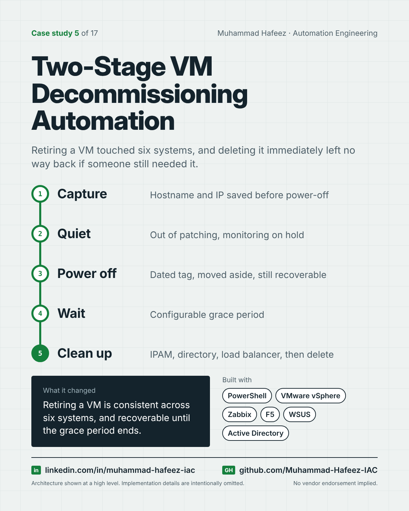

# Two-Stage VM Decommissioning Automation



## What it did

A two-stage PowerShell workflow for retiring virtual machines. Stage one records what the VM is, removes it from patching and monitoring noise, powers it off and marks it with a dated tag. After a grace period, stage two finds expired VMs and cleans them out of IP management, the directory, load balancers and monitoring before deleting them.

## How it works

1. **Capture** — Hostname and IP saved before power-off
2. **Quiet** — Out of patching, monitoring on hold
3. **Power off** — Dated tag, moved aside, still recoverable
4. **Wait** — Configurable grace period
5. **Clean up** — IPAM, directory, load balancer, then delete

**Built with:** PowerShell · VMware vSphere (PowerCLI) · Zabbix API · F5 BIG-IP · WSUS · Active Directory · IPAM · Syslog + SMTP

## Snippet

A simplified example that shows the idea. It is not taken from the original code.

```powershell
# Stage 2: only delete VMs whose decommission tag is older than the grace period (illustrative)
$graceDays = 14
foreach ($vm in Get-VMsWithDecomTag) {
    if ((Get-Date) - $vm.DecomDate -gt [TimeSpan]::FromDays($graceDays)) {
        Remove-FromDependentSystems $vm
        Remove-VMPermanently $vm
    }
}
```

---

Implementation details, source code and internal names are intentionally not published.

**Muhammad Hafeez** · [LinkedIn](https://www.linkedin.com/in/muhammad-hafeez-iac) · [GitHub](https://github.com/Muhammad-Hafeez-IAC) · [All projects](../README.md)
